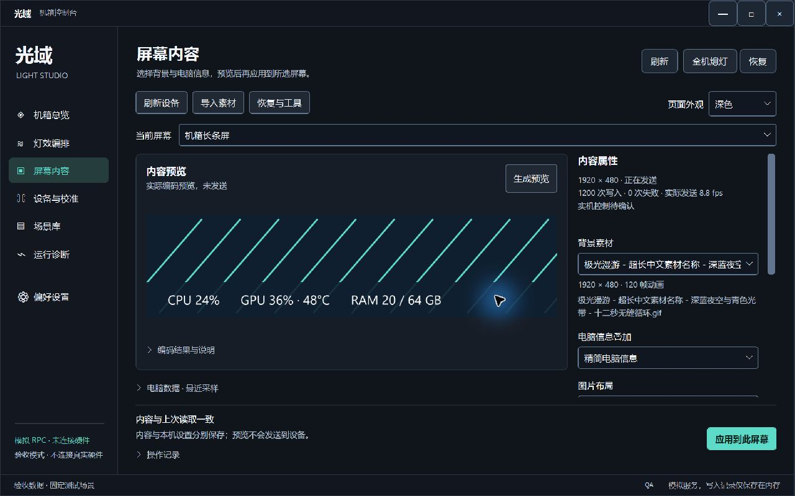
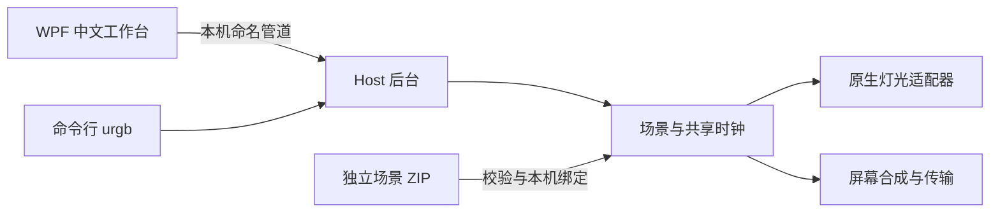

# 光域 · UnifiedRGB

**一个场景，控制整个机箱的灯光与屏幕。**

[](https://github.com/zhr2038/UnifiedRGB/actions/workflows/windows.yml)

光域是面向 Windows 的机箱控制程序：使用原生设备后端管理风扇灯光、冷头灯环、显卡、主板、内存和 LCD，将灯效编排、屏幕动画与电脑信息放在同一个工作台中。

项目采用 **C# / .NET 8 / WPF**。Python 仅用于场景包制作工具，运行主程序不需要 Python。

> 当前发布的是开发预览源码。可构建的 Windows 安装程序、首次设备配置向导和完整的分发依赖正在整理，**目前还没有“下载后直接安装使用”的正式安装包**。请勿将本仓库的源码压缩包当作安装包。

## 已有功能

- **中文工作台**：机箱总览、灯效编排、屏幕内容、设备与校准、场景库、运行诊断及偏好设置。
- **屏幕内容页试点**：按窗口空间切换三区、两区或紧凑布局；页面内深浅主题、清晰焦点、忙碌/错误/断线状态，分别保存本机设置与应用内容。
- **全机灯效**：颜色、呼吸、流动、堆积与波浪回退；串行路径、并行设备组、方向、安装映射和冷头灯环校准。
- **统一时序**：无线设备播放上传的动画循环；原生直驱设备按共享时间模型跟随，支持接收状态核对与有界重传。
- **原生屏幕**：风扇 LCD、H2 冷头屏和受支持的 TURZX 长条屏；图片/GIF 背景、电脑数据叠加、逐屏内容和编码结果预览。
- **本机屏幕设置**：按 ScreenId 保存 0°/90°/180°/270° 安装方向，切换场景包时保留；PNG 编码质量策略可单独保存。
- **通用场景包**：导入独立 ZIP，预览内容，为角色绑定本机灯区与屏幕。新主题通过数据包扩展，无需为每个主题修改程序。
- **运行维护**：托盘、后台计划任务、冲突检测、设备重新发现、联力重新同步，以及受支持的风扇 LCD 组重启。
- **场景库管理**：查看包数量和容量，检查播放、恢复及保存记录的引用，删除未引用的包并选择性回收素材；保留本机绑定历史。单屏调整显示属性时保留共享时间轴，更换素材才确认脱离同步。



上图来自真实 Windows WPF 窗口，使用模拟设备和合成数据，未连接真实硬件。当前只迁移“屏幕内容”页，主题选择仅作用于该页面和当前会话；完整 DPI 验收仍未完成。[查看前后对比、浅色页面和验收范围](design/SCREEN-PILOT-VALIDATION.zh-CN.md)。

## 硬件支持范围

下表区分当前实机接入与其他型号的兼容性。相同品牌、接口或外观不代表协议一定兼容。

| 类型 | 已接入范围 | 说明 |
| --- | --- | --- |
| 联力无线灯光 | TL120 / TL140 风扇链、H2 冷头灯环 | 原生 WinUSB / RF；链方向和安装角度按本机配置 |
| MSI 显卡灯光 | 已验证的 RTX 5090 SUPRIM 对应控制器 | 原生 NVIDIA 驱动接口；其他显卡不能据此视为已支持 |
| ASUS 主板灯光 | 已验证的 Aura HID 控制器及板载 ROG 灯区 | 使用受支持的 HID 集合；ARGB 接头须正确配置灯数 |
| RGB 内存 | 已验证的 ENE 控制器 | 通过 PawnIO / SMBus；模块、库和硬件身份有校验门槛 |
| 联力风扇 LCD | 已验证的 TL LCD 无线屏 | 原生屏幕传输，与扇叶转速控制分离 |
| 冷头 LCD | 已验证的 H2 屏 | 原生画面上传与信息叠加 |
| TURZX 屏 | 已验证的 `1CBE:0088`，1920×480 横向画布 | 内部转换为设备的 480×1920 光栅；不与用户安装旋转混淆 |
| 虚拟设备 | 内置 | 无硬件时用于开发与逻辑验证 |
| OpenRGB SDK | 可选兼容适配器 | 当前上述原生接入不需要启动 OpenRGB；此适配器默认关闭 |

当前原生 GPU / 主板 / 内存 / 屏幕传输不需要 MSI Center、Armoury Crate、L-Connect 或 TURZX 控制程序在后台运行。Windows USB 绑定、显卡驱动、PawnIO 等必要设备驱动仍需正确安装。

**联力灯光默认使用独立的托管 C# 无损压缩器**，不需要 `yuz.dll` 或厂商安装目录。匹配搜索与双路径选择针对 RGB 循环设计；线格式与有边界检查的解码器参考 MIT 许可的 tinyuz 1.1.1，保留[第三方声明](THIRD-PARTY-NOTICES.md)及随程序输出的许可原文，不将上游算法称为完全自创。

当前4KiB兼容版通过186组离线交叉解码，保持全部颜色和帧数据；本机这组样本压缩耗时约降至原厂路径的1/27，总压缩体积增加约12.1%，全部低于12KiB预算，没有新增抽帧。它的收益是独立分发与CPU速度；不宣称压缩率优于原厂或提高硬件播放帧率。最初64KiB窗口版虽能通过电脑解码，在风扇实机上仍被拒绝，已由4KiB版本取代；修正版经用户确认灯光与屏幕均正常。验证范围、回退方式和实机状态见[压缩器交付记录](design/MANAGED-RF-CODEC-20261020.zh-CN.md)。

仅需本机比较或回退时，可显式设置 `UnifiedRgb:LianLi:Codec=VendorYuz` 和合法取得的 x64 `YuzDllPath`；默认 `Managed` 会忽略旧 DLL 路径。没有自动搜索或隐式切回厂商 DLL，本仓库仍不分发该 DLL。

## 从源码构建

需要 Windows x64、.NET 8 SDK 和 Git。首次还原依赖需要访问 NuGet。命令在仓库根目录执行：

`global.json` 将构建 SDK 限制在8.x，并允许使用已安装的较新8.x功能带，避免多SDK环境自动选用其他主版本。

```powershell
git clone https://github.com/zhr2038/UnifiedRGB.git
cd UnifiedRGB

dotnet restore .\src\UnifiedRgb.sln
dotnet build .\src\UnifiedRgb.sln -c Release --no-restore -warnaserror
dotnet test .\src\UnifiedRgb.sln -c Release --no-build -m:1
```

源码默认启用虚拟适配器，关闭全部真实硬件输出；默认无线设备列表为空。构建和测试不会复制作者机器的配置、自动停止厂商程序或点亮设备。

开发者可在新环境中启动后台与界面：

```powershell
# 后台负责硬件访问；界面验证连接到同一用户的管理员后台。
Start-Process .\src\UnifiedRgb.Host\bin\Release\net8.0-windows\UnifiedRgb.Host.exe -Verb RunAs
Start-Process .\src\UnifiedRgb.App\bin\Release\net8.0-windows\UnifiedRgb.App.exe
```

请勿在同一台电脑同时启动两个硬件后台，也不要将源码默认配置覆盖到已有安装。真实设备启用、驱动准备、控制验证和场景绑定仍需要针对本机完成；通用首次配置与标准安装交付尚未完成。

配置入口是 Host 目录的 `appsettings.json`。设备类开关、协议身份、驱动/模块路径和控制验证是不同设置；不要为了消除“未就绪”提示而批量将校验字段改成 `true`。

### 测试说明

测试覆盖效果数学、上传预算、传输规则、设备状态机、场景包安全与事务、屏幕编码和方向持久化、界面草稿及恢复行为。

- 通用回归使用仓库内的合成样例和 fake 设备，无需机箱硬件。
- 建议按上述命令串行运行测试程序集，避免调度计时测试与其他进程的 WPF 编码测试争用资源；计时测试仍保留原有2ms阈值。
- 托管压缩器的通用特效预算、堆积回退、参考向量及异常输入测试不依赖私有资源，公开 CI 同样执行。涉及原厂 DLL 的额外交叉解码、历史固定预算及原始厂商记录是**条件测试**；缺少资源明确跳过，不等同于实机验证。
- `URGB_YUZ_DLL` 可指定本机合法取得的压缩组件；部分历史预算测试还要求本机固定 SHA 的私有资源。这些文件不会被 CI 自动下载。
- 内嵌效果数据始终核对固定长度和 SHA；额外的私有反编译原文对照仅在本机原始材料存在时执行。
- 独立 Windows CI 会从公开源码执行构建与回归。通过软件测试不等于所有型号均已完成物理播放验收。

场景包工具的测试可单独执行，需要 Python 3.10+，仅使用标准库：

```powershell
python -m unittest discover -s .\tools\scene-packages -p "test_*.py"
```

## 制作与导入场景包

完整契约、容量限制、灯光数据格式、时间轴和设备绑定说明见 **[中文场景包开发规范](design/SCENE-PACKAGE-DEVELOPER-GUIDE.zh-CN.md)**。

```powershell
python .\tools\scene-packages\pack_scene.py sample .\my-scenes\aurora
# 修改生成目录中的 scene.json、lighting 与 screens 素材。
python .\tools\scene-packages\pack_scene.py build .\my-scenes\aurora .\my-scenes\aurora-r1.zip
```

通用示例：[极光示例源目录](assets/scenes/examples/aurora-starter) · [可导入 ZIP](assets/scenes/examples/aurora-starter-v1.zip)。

在界面中依次操作：**场景库 → 外部场景包 → 导入 → 选择本机设备 → 保存设备绑定 → 应用场景包**。

导入、预览和保存绑定不会切换当前播放内容。内容按哈希保存；设备绑定、安装方向和本机校准与原包分开。v1 包只包含数据与素材，不执行脚本或插件 DLL。

需要在矩形屏幕上指定电脑数据的显示区域时，显式使用 **schemaVersion 2**。v2 增加可选 `accentColor` 和归一化 `overlayLayout`，由底座采集并叠加真实电脑数据；不改变 v1 的字节、播放契约和拒绝规则。圆形屏幕不接受区域布局，错误绑定会明确拒绝并保留原场景。

```powershell
python .\tools\scene-packages\pack_scene.py sample .\my-scenes\region-starter --schema 2
```

## 屏幕画质与已知限制

- 支持 PNG / JPEG / GIF，以及通过 Windows Media Foundation 导入 MP4/H.264 SDR（不播放音频，12 MiB / 30 秒 / 1800 帧）。同步 MP4 场景须显式使用 schemaVersion 3；v1/v2 含义和旧包保持不变，不引入任意视频插件或新的播放契约。
- TURZX 单张 PNG 图片数据上限为 **524288 字节**；不能靠增大软件常量突破设备协议。
- `legacy` 保持旧的编码策略。可选 `lossless-first-v1` 在必要时先尝试有界无损优化，再使用原有降色路径；能装下的原始全色 PNG 保持原输出。
- Indexed8 PNG 的设备固件接受情况尚未确认，未默认开放。预览显示实际编码后的画面或明确失败，不用原图假装编码成功。
- 图像“亮度”和硬件背光分开处理；全机熄灯已支持当前验证过的五块屏幕原生关闭背光，并保留恢复亮度。不能据此推断其他型号支持同样命令。
- 实际发送帧率受编码、素材、数据叠加与设备链路影响。目标帧率、完整图像事务速率、素材独立帧数与实际可见帧率分别记录；重复发送同一帧不能被标成动画帧率提升，硬件极限仍未确定。
- 无线上传成功与接收代次匹配是通信证据，不能替代每个接收设备的物理播放观察。

## 程序结构



| 目录 | 职责 |
| --- | --- |
| `src/UnifiedRgb.App` | WPF 界面、托盘、草稿与本机 IPC 客户端 |
| `src/UnifiedRgb.Host` | 后台、持久化、设备接管、场景包事务与计划任务 |
| `src/UnifiedRgb.Core` | 效果、空间布局、动画循环、调度和时间模型 |
| `src/UnifiedRgb.Devices.*` | 各类设备适配器及抽象 |
| `src/UnifiedRgb.Transports.Win` | WinUSB / HID / NVIDIA / SMBus 与传输限制 |
| `src/UnifiedRgb.Screens` | 素材、合成、编码、电脑数据与原生屏幕输出 |
| `src/UnifiedRgb.Contracts`、`src/UnifiedRgb.Cli` | IPC 契约与命令行 |
| `tests` | 通用回归、合成协议样例和条件本机验证 |
| `tools/scene-packages` | 通用场景包生成与检查 |
| `tools/pawnio` | 固定版本模块、对应源文件、来源和许可 |

本机运行数据默认位于 `%ProgramData%\UnifiedRgb`，界面日志位于 `%LocalAppData%\UnifiedRgb\logs`。源码仓库不包含用户场景、真实安装校准、驱动安装包、设备占用记录或本机调试档案。

## 后续交付

屏幕性能与原生视频的研究见 [五屏画质与 MP4 研究](design/SCREEN-QUALITY-AND-VIDEO-20261021.zh-CN.md)，本轮代码和实机结果见 [原生视频实现记录](design/NATIVE-VIDEO-IMPLEMENTATION-20261021.zh-CN.md)。MP4 使用原有统一时间轴选帧，长屏 H.264 独立关键帧路径保留实时电脑信息 PNG 叠加，不调用厂商程序。原生策略默认关闭，只向单独完成同步、循环和叠加验证的设备开放；成功传输不代表实际可见帧率或光学同步通过。

1. 自带运行环境的 Windows 安装程序，以及升级、卸载、开始菜单与启动项验证。
2. 针对当前电脑的首次设备检测、依赖准备与可理解的控制验证流程。
3. 按 [Windows 应用交付方案](design/WINDOWS-APPLICATION.md) 和 [设计系统](DESIGN_SYSTEM.md) 推广已实现的屏幕页试点，并完成剩余 DPI 与无障碍验收；保留 WPF 与现有业务接口。

这些项目仍在开发，不能将设计文档当作已上线功能。

## 第三方与许可

参见 [第三方说明](THIRD-PARTY-NOTICES.md)、[屏幕协议来源说明](src/UnifiedRgb.Screens/THIRD-PARTY-NOTICES.md) 及 [PawnIO 模块来源](tools/pawnio/PROVENANCE.md)。本仓库目前尚未指定项目级开源许可证；第三方组件仍遵守其各自许可。

光域与文中硬件品牌没有官方隶属关系。欢迎通过 [Issues](https://github.com/zhr2038/UnifiedRGB/issues) 提交可复现的问题和设备兼容信息；提交日志前请先去除个人路径、设备序列号和凭据。
