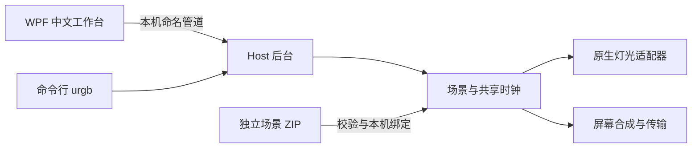

# 光域 · UnifiedRGB

**一个场景，连接整个机箱的灯光、屏幕与外设。**

[](https://github.com/zhr2038/UnifiedRGB/actions/workflows/windows.yml)

光域是面向 Windows 的中文机箱控制程序：使用原生设备后端管理风扇灯光、冷头灯环、显卡、主板、内存、五块机箱 LCD，以及已接入的 ROG 键盘和鼠标，将灯效、画面、电脑信息与机箱开关放在同一个工作台中。

项目采用 **C# / .NET 10 LTS / WPF**。Python 仅用于场景包制作工具，运行主程序不需要 Python。

[下载安装包](https://github.com/zhr2038/UnifiedRGB/releases) · [场景包开发指南](design/SCENE-PACKAGE-DEVELOPER-GUIDE.zh-CN.md) · [Windows 打包说明](tools/packaging/README.md) · [报告问题](https://github.com/zhr2038/UnifiedRGB/issues)

> 本页描述当前 `main` 源码。已发布安装包可能早于最新外设功能，请核对相应 Release 的说明。仓库不分发本机固件镜像、真实设备绑定、实际校准或用户配置。

Windows x64 自包含安装包通过 [GitHub Releases](https://github.com/zhr2038/UnifiedRGB/releases) 分发。选择 `Guangyu-…-win-x64-Setup.exe`，无需另装 .NET 或 Python；源码 ZIP 不是安装包。安装包未做商业代码签名，Windows 可能显示未知发布者提示。

安装后从开始菜单打开“光域 · 设备配置”，选择演示或本机硬件，核对变更后保存，再启动“光域”。驱动、硬件型号、设备控制验证和场景绑定仍须针对本机完成，不承诺支持任意品牌型号。当前安装模型为同一 Windows 账户的管理员后台与普通权限界面，多用户及使用另一管理员账户凭据安装尚未验收。

## 已有功能

- **黑金中文工作台**：纯黑、石墨与香槟金配色，包含机箱总览、内置灯效、外部导入、屏幕内容、设备校准、场景库、诊断及偏好设置。
- **屏幕内容页试点**：按窗口空间切换三区、两区或紧凑布局；页面内深浅主题、清晰焦点、忙碌/错误/断线状态，分别保存本机设置与应用内容。
- **全机灯效**：颜色、呼吸、流动、堆积与波浪回退；串行路径、并行设备组、方向、安装映射和冷头灯环校准。
- **机箱总览与开关**：查看灯光、屏幕和外设状态，执行全机熄灯或恢复；重复熄灯保留恢复点，已运行的场景不会因重复开启意图而重新开始。
- **ROG 外设**：键盘及鼠标整区 RGB、键盘 OLED 状态与动画接口，以及经本机验证的原生“光域”菜单控制。逐键 RGB 已加入源码，完整键表仍待实机验收。
- **统一时序**：无线设备播放上传的动画循环；原生直驱设备按共享时间模型跟随，支持接收状态核对与有界重传。
- **原生五屏**：三块 TL 风扇 LCD、H2 冷头屏和受支持的 TURZX 长条屏；图片/GIF/受支持的 MP4 背景、电脑数据叠加、逐屏内容和编码结果预览。
- **本机屏幕设置**：按 ScreenId 保存 0°/90°/180°/270° 安装方向，切换场景包时保留；PNG 编码质量策略可单独保存。
- **JPEG 细节优先**：风扇屏/冷头的可选本机策略，从 Q100 起步并在原容量内回退；旧默认输出保持。三块风扇屏已实测真正 60fps MP4 素材，走主机解码/JPEG 通道，不要求刷固件。
- **通用场景包**：导入独立 ZIP，预览内容，为角色绑定本机灯区与屏幕。新主题通过数据包扩展，无需为每个主题修改程序。
- **外部效果调参**：灯光亮度、色相、整体速度、反向与启用；逐屏画面亮度、适配、监控叠层和显示区域。保留原 ZIP，将参数与绑定保存为独立版本，也可另存为场景。
- **动态机箱示意图**：按校验后的原始 RGB 帧预演，叠加屏幕素材，支持播放、暂停和拖动时间轴。三风扇显卡的竖向灯条位于相邻风扇之间；结构示意不改写设备校准。预览不发送到硬件。
- **分段媒体**：schema4 场景包可在一条时间轴连续播放多段 MP4；共享速度和反向处理保留原素材，应用前仍检查设备时钟精度与传输预算。
- **有界分块导入**：新界面分块上传场景包，保留原 ZIP、内容哈希与旧 Host 兼容；校验和安装完成前不切换灯光或屏幕。
- **运行维护**：托盘、后台计划任务、冲突检测、设备重新发现、联力重新同步，以及受支持的风扇 LCD 组重启。
- **场景库管理**：查看包数量和容量，检查播放、恢复及保存记录的引用，删除未引用的包并选择性回收素材；保留本机绑定历史。单屏调整显示属性时保留共享时间轴，更换素材才确认脱离同步。


上图保留早期屏幕页试点的真实 Windows WPF 截图，使用模拟设备和合成数据。当前程序已采用统一黑金界面；[新版工作台与参数版本说明](design/UI-V3-NATIVE-WORKBENCH-20261022.md)。屏幕页仍可独立选择外观；完整跨 DPI 验收尚未完成。[查看早期前后对比和验收范围](design/SCREEN-PILOT-VALIDATION.zh-CN.md)。

## 硬件支持范围

下表区分当前实机接入与其他型号的兼容性。相同品牌、接口或外观不代表协议一定兼容。

| 类型 | 已接入范围 | 说明 |
| --- | --- | --- |
| 联力无线灯光 | TL120 / TL140 风扇链、H2 冷头灯环 | 原生 WinUSB / RF；链方向和安装角度按本机配置 |
| MSI 显卡灯光 | 已验证的 RTX 5090 SUPRIM 对应控制器 | 原生 NVIDIA 驱动接口；其他显卡不能据此视为已支持 |
| ASUS 主板灯光 | 已验证的 Aura HID 控制器及板载 ROG 灯区 | 使用受支持的 HID 集合；ARGB 接头须正确配置灯数 |
| RGB 内存 | 已验证的 ENE 控制器 | 通过 PawnIO / SMBus；模块、库和硬件身份有校验门槛 |
| 联力风扇 LCD | 已验证的 TL LCD 无线屏 | 原生屏幕传输，与扇叶转速控制分离 |
| 冷头 LCD | 已验证的 H2 屏 | 原生画面上传与信息叠加 |
| TURZX 屏 | 已验证的 `1CBE:0088`，1920×480 横向画布 | 内部转换为设备的 480×1920 光栅；不与用户安装旋转混淆 |
| ROG 键盘 | Azoth X，USB / 2.4GHz RF 已接入 | 整区 RGB、OLED 与原生菜单按各自条件准入；逐键仅完成下述单键实机验证 |
| ROG 鼠标 | Harpe II Extreme Edition20，已验证的 2.4GHz RF 路线 | area0 是一个整区逻辑点，不是独立多灯区或逐灯映射 |
| 虚拟设备 | 内置 | 无硬件时用于开发与逻辑验证 |
| OpenRGB SDK | 可选兼容适配器 | 当前上述原生接入不需要启动 OpenRGB；此适配器默认关闭 |

当前原生 GPU / 主板 / 内存 / 屏幕及上述 ROG 接入不需要 MSI Center、Armoury Crate、L-Connect 或 TURZX 控制程序在后台运行。Windows USB 绑定、显卡驱动、PawnIO 等必要设备驱动仍需正确安装。本页不声明蓝牙路线已支持；查询身份、RGB、OLED 和原生菜单的验证不能相互替代。

**联力灯光默认使用独立的托管 C# 无损压缩器**，不需要 `yuz.dll` 或厂商安装目录。匹配搜索与双路径选择针对 RGB 循环设计；线格式与有边界检查的解码器参考 MIT 许可的 tinyuz 1.1.1，保留[第三方声明](THIRD-PARTY-NOTICES.md)及随程序输出的许可原文，不将上游算法称为完全自创。

当前4KiB兼容版通过186组离线交叉解码，保持全部颜色和帧数据；本机这组样本压缩耗时约降至原厂路径的1/27，总压缩体积增加约12.1%，全部低于12KiB预算，没有新增抽帧。它的收益是独立分发与CPU速度；不宣称压缩率优于原厂或提高硬件播放帧率。最初64KiB窗口版虽能通过电脑解码，在风扇实机上仍被拒绝，已由4KiB版本取代；修正版经用户确认灯光与屏幕均正常。验证范围、回退方式和实机状态见[压缩器交付记录](design/MANAGED-RF-CODEC-20261020.zh-CN.md)。

仅需本机比较或回退时，可显式设置 `UnifiedRgb:LianLi:Codec=VendorYuz` 和合法取得的 x64 `YuzDllPath`；默认 `Managed` 会忽略旧 DLL 路径。没有自动搜索或隐式切回厂商 DLL，本仓库仍不分发该 DLL。

## 键盘原生菜单、OLED 与逐键 RGB

### 原生“光域”控制

在**已安装并验证本机定制原生固件**的键盘上，用户已确认 USB 与 RF 两条路线的原生“光域”控制：中键切换全机熄灯 / 恢复，上拨和下拨选择配置好的场景。原有 Volume / Media / Brightness / Custom 模式与自定义绑定需要保留。

独立原生菜单需要本机定制固件的能力支持；只安装本程序不会给原厂键盘自动新增菜单。定制镜像与刷写材料不在此仓库分发，不能通过改写本机标记伪装固件能力。

| 画面 | 用途与条件 |
| --- | --- |
| 入场 Logo | 原生“光域”入口的品牌画面，名义停留约 1.2 秒；新的位图修正候选仍待独立实机验收 |
| 机箱状态页 | 根据实际 Host 状态显示机箱信息，不将请求受理当成硬件完成 |
| 自制场景动画 | 从当前共享屏幕场景选择素材，转换为 208×64、16 级灰度 OLED 帧；需单独开启、绑定并通过当前显示能力准入 |

自制动画沿用场景的共享时间位置，不因进入菜单从第零帧另起时钟。当前上传节流默认 2000ms，不承诺 OLED 15/30/60fps，也不等于直接上传原生 GIF。入场 Logo、状态页与作者动画的呈现条件各不相同，接口及限制见[场景包开发指南](design/SCENE-PACKAGE-DEVELOPER-GUIDE.zh-CN.md)的外设章节。

### 逐键 RGB 的当前进度

2026-10-29，用户分别确认了 **USB 与 RF 路线的单个 Esc 键显示红色**。完整 81 键键表、逐键空间效果与主题制作交付尚未完成实机验收。协议中的记录数量或候选映射不能替代完整键位验证。

逐键 RGB 使用自己的协议初始化与本机映射门槛，不依赖此次入场 Logo 位图刷写。键名、逻辑布局与原生 LED ID 的关系留在本机；场景包只交付匹配灯位数的 RGB24 内容。W/A/S/D 高亮、波浪和涟漪的制作方法见开发指南，不能把制作能力描述为当前全键盘已经验收。

## 从源码构建与运行

需要 Windows x64、.NET 10 SDK 和 Git。首次还原依赖需要访问 NuGet。命令在仓库根目录执行：

`global.json` 以 SDK 10.0.402 为基线，在 .NET 10 内允许较新功能带，不切换到其他主版本。WPF、MVVM、AsyncCommand、Host 和 RPC 架构保留。

```powershell
git clone https://github.com/zhr2038/UnifiedRGB.git
cd UnifiedRGB

dotnet restore .\src\UnifiedRgb.sln
dotnet build .\src\UnifiedRgb.sln -c Release --no-restore -warnaserror
dotnet test .\src\UnifiedRgb.sln -c Release --no-build -m:1
```

源码默认启用虚拟适配器，关闭真实设备后端和屏幕输出；无线设备列表与 ROG 设备绑定为空。构建不会复制作者机器的配置，也不会自动停止厂商程序。

开发者可在没有现有后台占用的新环境中启动后台与界面：

```powershell
# 后台负责硬件访问；界面验证连接到同一用户的管理员后台。
Start-Process .\src\UnifiedRgb.Host\bin\Release\net10.0-windows\UnifiedRgb.Host.exe -Verb RunAs
Start-Process .\src\UnifiedRgb.App\bin\Release\net10.0-windows\UnifiedRgb.App.exe
```

请勿在同一台电脑同时启动两个硬件后台，也不要将源码默认配置覆盖到已有安装。真实设备启用、驱动准备、控制验证和场景绑定仍需要针对本机完成。安装包构建与隔离生命周期验证入口见 [Windows 打包工具](tools/packaging/README.md)。

配置入口是 Host 目录的 `appsettings.json`。设备类开关、协议身份、驱动/模块路径和控制验证是不同设置；不要为了消除“未就绪”提示而批量将校验字段改成 `true`。

### 测试说明

测试覆盖效果数学、上传预算、传输规则、设备状态机、场景包安全与事务、屏幕编码和方向持久化、界面草稿及恢复行为。

当前完整回归仍有已知基线失败，不能据本页或定向测试结果宣称全套通过。CI 的实际结果以对应提交的 [Actions](https://github.com/zhr2038/UnifiedRGB/actions) 为准。

- 通用回归使用仓库内的合成样例和 fake 设备，无需机箱硬件。
- 建议按上述命令串行运行测试程序集，避免调度计时测试与其他进程的 WPF 编码测试争用资源；计时测试仍保留原有2ms阈值。
- 托管压缩器的通用特效预算、堆积回退、参考向量及异常输入测试不依赖私有资源，公开 CI 同样执行。涉及原厂 DLL 的额外交叉解码、历史固定预算及原始厂商记录是**条件测试**；缺少资源明确跳过，不等同于实机验证。
- `URGB_YUZ_DLL` 可指定本机合法取得的压缩组件；部分历史预算测试还要求本机固定 SHA 的私有资源。这些文件不会被 CI 自动下载。
- 34 个通用生成器保留原有数学金样；厂商采样表和移植动画体已从当前产品移除。旧版厂商逐字节对照不再冒充新内容的验收，路径、堆积、回退、方向和预算继续回归。
- 独立 Windows CI 会从公开源码执行构建与回归。通过软件测试不等于所有型号均已完成物理播放验收。

场景包工具的测试可单独执行，需要 Python 3.10+，仅使用标准库：

```powershell
python -m unittest discover -s .\tools\scene-packages -p "test_*.py"
```

## 制作与导入场景包

完整契约、容量限制、灯光数据格式、时间轴和设备绑定说明见 **[中文场景包开发规范](design/SCENE-PACKAGE-DEVELOPER-GUIDE.zh-CN.md)**。

程序输出包含该指南、打包脚本和极光示例。键盘/鼠标整区 RGB 使用单逻辑点轨道；逐键轨道必须匹配已经验证的本机布局。键盘 OLED 当前没有独立的场景包角色绑定入口，需要从已应用的普通屏幕场景中选择素材，经单独的本机接口准备和启用。沿用现有 v1–v4 格式，不增加外设专属清单字段。

```powershell
python .\tools\scene-packages\pack_scene.py sample .\my-scenes\aurora
# 修改生成目录中的 scene.json、lighting 与 screens 素材。
python .\tools\scene-packages\pack_scene.py build .\my-scenes\aurora .\my-scenes\aurora-r1.zip
```

通用示例：[极光示例源目录](assets/scenes/examples/aurora-starter) · [可导入 ZIP](assets/scenes/examples/aurora-starter-v1.zip)。

在界面中依次操作：**场景库 → 外部场景包 → 导入 → 选择本机设备 → 保存设备绑定 → 应用场景包**。

导入、预览和保存绑定不会切换当前播放内容。内容按哈希保存；设备绑定、安装方向和本机校准与原包分开。v1 包只包含数据与素材，不执行脚本或插件 DLL。

最多同时保留两个上传或正在完成安装的会话，每包至多 64 MiB。上传必须按顺序、满足声明大小与 SHA-256；过期或失败时回收暂存文件。旧后台不支持分块入口时才在开始阶段回退旧导入，失败的安装不会换接口重复提交。

设备写入停止、重连、界面异常隔离和场景状态恢复的本轮修复及验证范围见 [审查修复记录](design/AUDIT-REMEDIATION-20261021.zh-CN.md)。场景事务损坏时，程序保留原文件与本机设置，进入禁输出修复模式；选择完整的灯光＋屏幕保存场景后重启后台，不会猜测并播放混合状态。

需要在矩形屏幕上指定电脑数据的显示区域时，显式使用 **schemaVersion 2**。v2 增加可选 `accentColor` 和归一化 `overlayLayout`，由底座采集并叠加真实电脑数据；不改变 v1 的字节、播放契约和拒绝规则。圆形屏幕不接受区域布局，错误绑定会明确拒绝并保留原场景。

```powershell
python .\tools\scene-packages\pack_scene.py sample .\my-scenes\region-starter --schema 2
```

## 屏幕画质与已知限制

- 支持 PNG / JPEG / GIF，以及通过 Windows Media Foundation 导入 MP4/H.264 SDR（不播放音频，12 MiB / 30 秒 / 1800 帧）。同步 MP4 场景须显式使用 schemaVersion 3；v1/v2 含义和旧包保持不变，不引入任意视频插件或新的播放契约。
- TURZX 单张 PNG 图片数据上限为 **524288 字节**；不能靠增大软件常量突破设备协议。
- `legacy` 保持旧的编码策略。可选 `lossless-first-v1` 在必要时先尝试有界无损优化，再使用原有降色路径；能装下的原始全色 PNG 保持原输出。
- Indexed8 PNG 的设备固件接受情况尚未确认，未默认开放。预览显示实际编码后的画面或明确失败，不用原图假装编码成功。
- 图像“亮度”和硬件背光分开处理；全机熄灯已支持当前验证过的五块屏幕原生关闭背光，并保留恢复亮度。不能据此推断其他型号支持同样命令。
- 实际发送帧率受编码、素材、数据叠加与设备链路影响。目标帧率、完整图像事务速率、素材独立帧数与实际可见帧率分别记录；重复发送同一帧不能被标成动画帧率提升，硬件极限仍未确定。
- 无线上传成功与接收代次匹配是通信证据，不能替代每个接收设备的物理播放观察。

## 程序结构



| 目录 | 职责 |
| --- | --- |
| `src/UnifiedRgb.App` | WPF 界面、托盘、草稿与本机 IPC 客户端 |
| `src/UnifiedRgb.Host` | 后台、持久化、设备接管、场景包事务与计划任务 |
| `src/UnifiedRgb.Core` | 效果、空间布局、动画循环、调度和时间模型 |
| `src/UnifiedRgb.Devices.*` | 各类设备适配器及抽象 |
| `src/UnifiedRgb.Devices.AsusRog` | ROG RGB、OLED、原生菜单与输入协议 |
| `src/UnifiedRgb.Transports.Win` | WinUSB / HID / NVIDIA / SMBus 与传输限制 |
| `src/UnifiedRgb.Screens` | 素材、合成、编码、电脑数据与原生屏幕输出 |
| `src/UnifiedRgb.Contracts`、`src/UnifiedRgb.Cli` | IPC 契约与命令行 |
| `tests` | 通用回归、合成协议样例和条件本机验证 |
| `tools/scene-packages` | 通用场景包生成与检查 |
| `tools/codegen` | 34 个通用特效的生成器与只读一致性检查 |
| `tools/pawnio` | 固定版本模块、对应源文件、来源和许可 |

源码仓库不包含用户场景、真实安装校准、设备占用记录、本机调试档案或定制固件镜像。

## 验证记录与后续范围

屏幕原生视频代码和实机结果见 [原生视频实现记录](design/NATIVE-VIDEO-IMPLEMENTATION-20261021.zh-CN.md) 及 [五屏 MP4 与冷头协议续作](design/FIVE-SCREEN-MP4-AND-H2-NATIVE-20261021.zh-CN.md)。MP4 使用原有统一时间轴选帧，长屏 H.264 独立关键帧路径保留实时电脑信息 PNG 叠加，不调用厂商程序。冷头 H.264 已在本机完成 5 秒通信和 60 秒限时试验，用户确认画面、黑位和同步正常；测试后恢复熄灯，未自动切换常用策略。冷头电脑信息可合入整幅视频画面，当前场景未启用该层，实机信息叠加仍未测。三块无线风扇屏已用 MP4 素材实测 JPEG 传输，尚无已验证的原生视频入口。原生策略默认关闭，只向单独完成对应验证的设备开放；本机限时验收不代表所有固件兼容或相机实测帧率。

风扇屏的实测见 [60fps 与 JPEG 细节优先记录](design/TL-SCREEN-60FPS-AND-DETAIL-20261021.zh-CN.md)：960 幅独立画面/16 秒的 MP4 经程序实际导入，三屏约 59.56 次主机事务/秒，用户确认流畅。要增加动作画面，需要真正的 60fps 素材并在 v3 包中设置 `fps: 60`；这些结果不代表 OLED、所有设备或叠加组合都有 60fps 保证。可选 `jpeg-detail-v1` 已完成原素材对照，用户确认细节改善。

安装与升级工具已有实现，入口见 [Windows 打包说明](tools/packaging/README.md)；具体安装包所包含的功能仍以其发布版本为准。后续重点包括完整键盘映射与逐键主题验收，以及按 [Windows 应用交付方案](design/WINDOWS-APPLICATION.md) 和 [设计系统](DESIGN_SYSTEM.md) 完成剩余 DPI 与无障碍验收。

当前不声明所有型号兼容、完整跨 DPI / 无障碍认证、蓝牙控制或 Home Assistant 集成已完成；设计文档不等同于已发布或实机验收。

## 第三方与许可

参见 [第三方说明](THIRD-PARTY-NOTICES.md)、[屏幕协议来源说明](src/UnifiedRgb.Screens/THIRD-PARTY-NOTICES.md)、[ROG 协议说明](src/UnifiedRgb.Devices.AsusRog/README.md) 及 [PawnIO 模块来源](tools/pawnio/PROVENANCE.md)。本仓库目前尚未指定项目级开源许可证；第三方组件仍遵守其各自许可。

光域与文中硬件品牌没有官方隶属关系。欢迎通过 [Issues](https://github.com/zhr2038/UnifiedRGB/issues) 提交可复现的问题和设备兼容信息；提交日志前请先去除个人路径、设备序列号和凭据。
