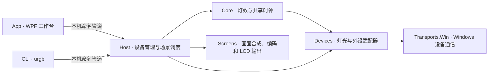

<p align="center">
  
</p>
<h1 align="center">光域 · UnifiedRGB</h1>
<p align="center">在一个 Windows 工作台里管理机箱灯光、屏幕和 ROG 外设。</p>

<p align="center">
  <a href="https://github.com/zhr2038/UnifiedRGB/releases/latest">下载 Windows 安装包</a>
  · <a href="design/SCENE-PACKAGE-DEVELOPER-GUIDE.zh-CN.md">场景包开发指南</a>
  · <a href="https://github.com/zhr2038/UnifiedRGB/issues">反馈问题</a>
</p>

<p align="center">
  <a href="https://github.com/zhr2038/UnifiedRGB/actions/workflows/windows.yml">
    
  </a>
</p>

## 能做什么

| 功能 | 已接入的设备与能力 |
| --- | --- |
| **机箱灯光** | 联力 TL120／TL140、H2 灯环、指定 MSI RTX 5090、ASUS Aura 主板和 ENE RGB 内存。支持统一灯效、全机熄灯和恢复。 |
| **机箱屏幕** | 三块联力 TL LCD、H2 冷头屏及受支持的 TURZX 长屏。支持图片、GIF、受支持的 MP4 和电脑状态叠加。 |
| **ROG 外设** | Azoth X 支持 USB／2.4 GHz、逐键 RGB 和 OLED。已接入 Harpe II Extreme Edition20 的 2.4 GHz 整区灯光。 |
| **场景库** | 保存并切换灯光与屏幕场景。可导入 ZIP 场景包、预览时间轴并绑定本机设备。 |
| **家庭看护联动** | 可选的 NAS 和 HA 联动。用 Azoth X 数字行提示床铺活动和哭声，通过键盘 HA 页开关。 |

支持范围取决于设备型号、驱动和固件。Azoth X 的光域、Codex 和 Home Assistant 原生页面需要相应的键盘固件及本机配置。 [ROG 设备与协议](src/UnifiedRgb.Devices.AsusRog/README.md) · [固件维护](design/KEYBOARD-FIRMWARE-DEVELOPMENT.zh-CN.md)

## 安装

在 Windows x64 上下载并运行 `Guangyu-…-win-x64-Setup.exe`。打开开始菜单中的「光域 · 设备配置」，选择演示模式或配置本机设备，再启动「光域」。安装包已包含 .NET 运行时。

本文档对应 `main`，安装包的功能以相应 Release 说明为准。 [Windows 打包与安装说明](tools/packaging/README.md)

## 架构



Host 统一管理设备连接和场景状态，原生适配器通过 Windows 驱动通信。场景可让灯光、机箱屏幕和键盘 OLED 共用时间轴；键盘也可独立显示设备动画、Codex 任务或 Home Assistant 场景。界面与命令行共用 `Contracts` 定义的 RPC，固件维护由独立的 `Firmware.Worker` 执行。

<details>
<summary>Home Assistant 键盘页配置</summary>

在 Host 的 `UnifiedRgb:KeyboardHomeAssistant` 下配置服务器根地址 `Url` 和 `Scenes`。每项填写 `EntityId`，支持 `scene.*` 与 `script.*`，可选 `Label`。建议使用 HTTPS，HTTP 限私有 IPv4 或本机回环地址。

在运行 Host 的 Windows 账户中添加通用凭据，目标名为 `UnifiedRgb/HomeAssistant/<协议与服务器地址>`，密码为 Home Assistant 访问令牌。键盘拨杆上下浏览，中按首页打开网页，中按场景执行当前项目。实机已验证 USB 脚本执行，以及 2.4 GHz 首页显示和浏览器启动请求。

</details>

## 可选的家庭看护联动

NAS 从已有 RTSP 流分析床铺活动和哭声。光域将结果临时叠加到键盘数字行。活动增加时灯条从绿区延伸到黄区，确认哭声才亮最后两个红键。键盘 HA 页可开启或关闭提示，关闭后恢复当前灯效。 [部署与验证说明](tools/child-monitor/README.md)

## 从源码构建

使用 Windows x64 和 .NET 10 SDK，在仓库根目录构建。

```powershell
dotnet build .\src\UnifiedRgb.sln -c Release -warnaserror
```

源码默认使用虚拟设备。Windows CI 验证软件回归、真实时钟和安装生命周期，USB／2.4 GHz 回归使用模拟 HID 通道。实机验证范围见 [功能审核记录](design/FUNCTIONAL-AUDIT-20261102.zh-CN.md) 和 [屏幕实测记录](design/FIVE-SCREEN-MP4-AND-H2-NATIVE-20261021.zh-CN.md)。

[第三方组件与许可](THIRD-PARTY-NOTICES.md)
