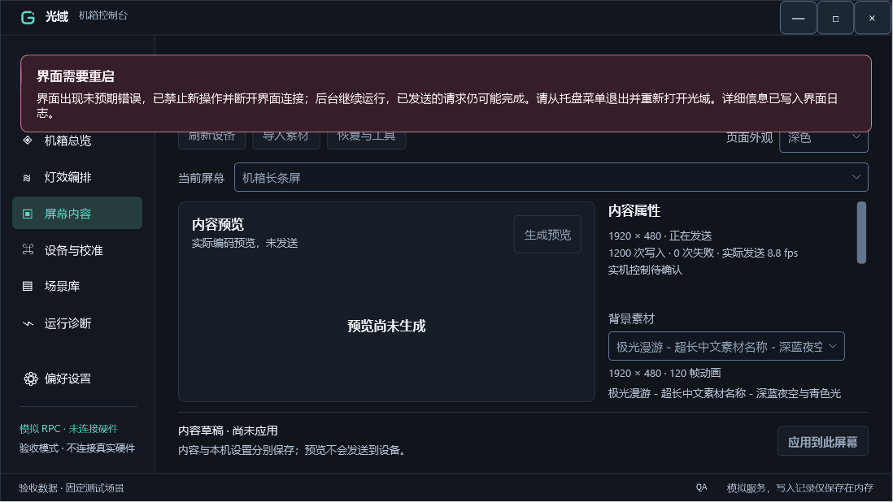
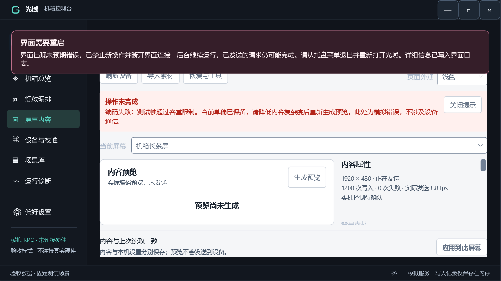

# 全程序审查修复记录（2026-10-21）

本轮依据 Fable 首轮报告及补充报告逐项核对当前代码。已存在的保护保留；补充报告撤回或收窄的结论按新证据处理。保持 .NET 8、WPF、现有 MVVM、AsyncCommand、Host 和 RPC，不改场景清单、素材、RGB24、编解码输出或设备控制命令的正常字节含义。

修复由 Codex 收尾并独立验证。Opus5.5 完成界面异常／管道诊断、分块导入两个有文件边界的子任务；Codex 继续审查并修正其最终提交配额、过期时钟、磁盘配额和界面故障边界。提帧研究为另一项工作，本次结果不代表冷头或长屏已达到60个不同画面／秒。

## 修复与逐项处置

| 条目 | 最终处理 |
| --- | --- |
| D1 写入阻塞导致停止挂起 | `DeviceWriter.StopAsync` 有界等待，HID 读写内部超时；未结束的写入不能与新 writer 重叠。设备交接用明确的有界 quiesce；普通暂停保留即时语义。异常终止时，硬件租约保持至进程退出。 |
| D2 维护命令重复租约 | `--restore-services` 取得租约失败时输出单行原因并返回2，不进入恢复服务逻辑。 |
| D3 分层覆盖遗漏 | AsusAura、EneDram 纳入适配器分层检查及允许引用检查。 |
| D4 可选 OpenRGB 重启风暴 | 有限启动预算、单调时钟退避、观察到稳定运行才重置预算；固定哈希拒绝仍明确报告，不当作已启动进程。原生后端不依赖此可选程序。 |
| D5 可选 SDK 重连 | 单调截止时间、I/O／断开异常处理、连接和握手超时、迟到连接释放、取消和定时器创建保护。未完成的旧连接不叠加创建新连接。 |
| D6 文本漂移 | 修正 schema1／2／3、独立视频／背光协议入口说明和容量错误文本。 |
| R1 列表与发现副作用 | 当前已有发现代次、退役 worker 所有权与迟到结果保护，保留。新增并发重复列表测试，确认每屏一个 worker／通道。 |
| R2 GPU 分组锁内休眠 | 释放等待移到分组锁外，同时保留独占释放标记；等待期间拒绝新帧，释放包与顺序不变。 |
| R3 SMBus 互斥 | 保留有界整组丢弃与超时统计，新增 abandoned 获取观测。未改 SMBus 读写字节或固定模块门槛。 |
| R4 ENE 吞吐 | 块写入的模块／寄存器支持未证实，保留现有逐字节协议；不尝试未知写入，不宣称性能提升。这是硬件实验项。 |
| R5 导入内存／遍历 | 新增有界分块 RPC，Host 自有暂存、顺序／长度／SHA 校验、超时／中止清理；reader/store 使用流，旧接口串行后解码且不再复制整个 ZIP。普通容量展示缓存；安装硬配额始终重新检查有界磁盘树，避免外部修改被漏计。 |
| R6 临时文件 | MP4 使用自有 scratch 目录，可选辅助程序使用自有配置目录；清理失败不能覆盖原始解码失败。 |
| R7 状态文件 | 唯一临时文件与同路径串行发布，替换失败保留上一份完整文件，清理失败不掩盖主错误。 |
| R8 界面吞异常 | 仅明确的断线类别正常恢复。未知错误进入不可继续操作的故障状态，关闭界面 RPC 会话以阻断缓存代理，保留页面草稿，显示独立提示，要求重开界面；后台保持独立运行。已送达的请求可能完成。 |
| R9 Aura 异常类型 | direct-mode 拒绝按 Blocked 分类，保留原始原因，失败后不继续发送颜色帧。 |
| R10 多发送器反馈 | 没有已验证的接收器配对时明确报告 Unknown，不发查询／自动重试，不把上传当交付。逐发送器关联仍是兼容能力限制。 |
| R11 预热任务 | 核对现有任务主体 catch，原审查也认定可接受；未为此重写。 |
| R12 STA 退出 | Join 超时后，解码线程最终结束时仍释放队列；重复及线程内释放有回归覆盖。 |
| R13 安装器 | 补充审查确认已有假平台竞态检查；重新验证这些已有保护。真实管理员安装、干净虚拟机与跨应用维护租约仍未完成。 |
| R14 物理行为／门槛 | 发行默认继续禁用未验证能力；安装方向与已验证 ID 仅属本机。已有设备试验不外推为所有固件能力。 |
| R15 FPS 范围 | 通用1～60是发送上限；包的 PNG／JPEG／GIF 仍上限15，v3 MP4 可到60。现有包读取器已有拒绝测试，不放宽旧包含义。 |

补充报告的相对 `YuzDllPath` 改为按应用基目录解析，独立于启动工作目录；默认仍用已部署的托管压缩器，没有加入或分发厂商 DLL。旧 Host 未提供控制验证字段时保守显示未验证；非原生设备保留相应的进程占用提示。

## 通用产品改进与边界

损坏事务保留原日志及三个状态文件的证据副本，原活动场景和本机设备设置不被自动重写。修复模式不构造设备适配器、不输出屏幕、不恢复厂商服务；只允许完整保存场景的离线恢复，当前进程保持禁输出至重启。无可用完整保存场景或原文件无法读取时，需要先修复数据，不能自动猜测。

新增 `UnifiedRgb:ExternalProcessWriters`，可为自有桥接程序配置进程名称和受影响的硬件类别。示例：

```json
{
  "UnifiedRgb": {
    "ExternalProcessWriters": [
      { "Name": "ExternalLightingBridge", "Affects": ["MsiGpu", "AsusAura"] }
    ]
  }
}
```

这份配置只增加写入占用阻挡，不授予停止任意服务或终止进程的权限，也不能删减内置厂商规则。历史兼容名称仍保留；通用规则的界面编辑器尚未实现。

34个通用特效生成器其实保留在本地，但被发布白名单排除。本轮纳入 `tools/codegen/gen_effects.py`，并增加 `--check`，全部34个生成结果与现有代码一致。厂商兼容动画和数据表另有来源，依赖私有反向工程输入的提取器未作为可重现公共生成器发布；这不构成全部代码为独立原创或已获得再分发许可的声明。

## 验证结果

独立最终构建0警告、0错误；同一轮依次运行全部五套测试，无失败、无跳过：

| 套件 | 通过 |
| --- | ---: |
| Core | 1014 |
| Devices | 409 |
| Host | 559 |
| Safety | 153 |
| Screens | 403 |
| 合计 | **2538** |

冻结989个构建／测试输入，验证结束及部署前无漂移。14个实际产品程序集的禁用标识扫描无命中。Python场景创作工具16项通过，通用特效生成器34项一致。

安装器假平台：PowerShell5.1和7分别42项通过、1项符号链接检查跳过；未把跳过算通过。没有做真实管理员安装或干净VM验证。

GitHub 对代码提交 `dd19997` 的[首轮CI](https://github.com/zhr2038/UnifiedRGB/actions/runs/39628654462)成功：.NET 2527项通过、11项私有资源检查跳过；Python16项、生成器34项一致。云端安装器假平台在PowerShell5.1与7均为43项通过、0跳过，与本机因符号链接权限跳过1项的环境不同。云端结果也不等于真实安装器管理员／干净VM验收。

最终约12.29MB真实结构RGB包的进程范围分配观测：旧导入49,427,224字节，新分块路径38,194,192字节，差约11.23MB。样本分别为4000／3999帧，源文件与Base64预先准备；这是Host测试进程的分配量，不是单次峰值，也不是App内存或64MiB满上限素材验证。完整测试进程峰值510,480,384字节不能归因于单次导入。

保留的失败包括：首轮异步分析器／测试编译问题、固定哈希拒绝被退避掩盖、状态替换并发、普通暂停被错误变为等待，以及首轮时钟过载。修复暂停回归后重新完成上述全套2538项，不拼接首轮结果，也未放宽原时钟门槛。

## 界面检查

在有HWND的隔离WPF窗口、fake RPC下验证故障提示、页面禁用、草稿保留及零硬件写入。实际测得175% DPI、物理窗口及客户区1920×1080、客户区约1097.14×617.14 DIP；分别检查深色草稿和浅色原错误状态。提示不依赖可能隐藏的常规错误栏。

下图为WPF诊断布局栅格，不是桌面截图，不作为完整M2／无障碍视觉验收：





100%／125%／150% DPI、屏幕阅读器、输入法及完整交互矩阵本轮未测。

## 部署状态

2026-10-21 23:40后台已更新至独立审查产物，复用已有计划任务，无新UAC。部署前后13191个场景、素材及本机配置文件哈希一致，当前场景／内容／设备设置读回一致，五屏仍为Sleeping且无错误。没有新增亮屏、彩色或提帧实机试验。

23:41界面文件更新完成，当前已打开窗口及未应用草稿保留，未强制重开；新界面代码在下次打开时生效。完整回退副本及失败记录保存在本机，未发布私有配置或设备数据。

冷头和长屏提帧研究已单独交给Opus5.5/xhigh，遇明确session额度限制后保存断点，安排额度恢复后继续。本轮没有修改实际帧率、常用编码策略、背光、共享时间轴或现有素材。
