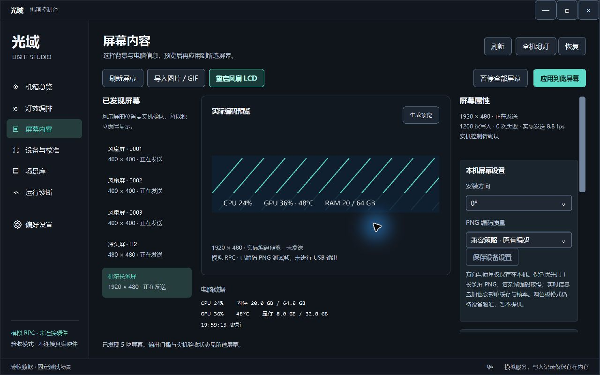
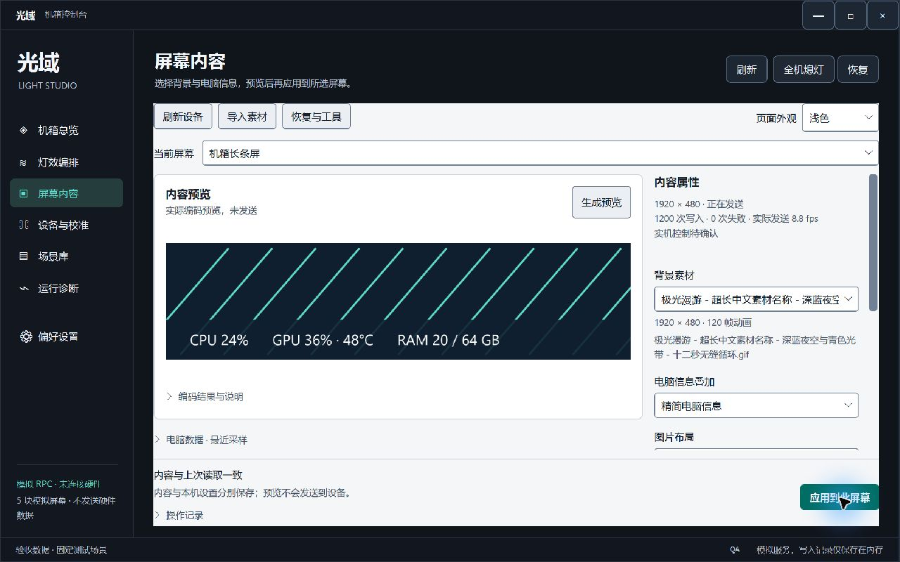

# 屏幕内容页试点：实现与验收范围

2026-10-19。保留 .NET 8 / WPF、MVVM、AsyncCommand、Host 和现有 RPC。本次 UI 不更换技术栈，不新增导航框架，不修改设备协议、编码输出或本机设置的持久化语义。本文只发布合成数据截图与可公开的验收摘要。

## 实际改动

- 使用页面局部的 `ScreenPilot.*` 资源和显式控件样式，不覆盖其他页面。
- 页面可用宽度 ≥1120 DIP 为设备/预览/属性三区，800～1119 DIP 为两区，更窄时切换预览与属性；高度不足时收起辅助区域。保留同一控件树和草稿，不靠整体缩放或缩小字体塞入。
- “保存设备设置”与“应用到此屏幕”独立，预览标明“实际编码预览，未发送”。
- 补充标签、可见键盘焦点、中文长文本、无设备、忙碌、错误详情和断线旧数据状态。无效数字输入阻止预览/应用，避免发送上一次有效值。
- 页面外观支持当前会话的深色、浅色与跟随系统。其他页面、全局主题持久化和灯效页的场景包只读摘要仍属后续范围。

## 同环境前后对比

截图均来自实际 Windows 窗口，屏幕有效 DPI 为168（175%），客户区为1280×800 DIP，对应2240×1400物理像素。工具输出的图片为1280×800栅格；不能把栅格尺寸当作测试了100% DPI。相同模拟设备、合成素材、滚动到顶部；截图中的数据、发送率和设备状态均为测试数据。

整改前的页面快照由开发工具承载，使用当前展示模型，并非旧版完整二进制回滚：

整改后，深色页面：

整改后，浅色仅作用于试点页面，既有外壳仍为原深色样式：

## 已完成的检查

在175% DPI下完成两轮真实桌面截图检查和修复，覆盖标准、宽和紧凑窗口，深浅页面、菜单、焦点、长错误、忙碌、空状态和断线显示。实际执行最大化、还原、拖动缩放及 Tab / Shift+Tab / 方向键 / Enter / Space / Escape 的代表性操作。

修复了实际发现的焦点提示不可见、菜单白色边沟与文字裁切、紧凑错误详情挤压控件、短窗口预览空间不足等问题。早期黑屏、旧帧和一次窗口越界截图未作为通过证据；失败记录在本地保留。

独立 fake RPC 窗口验证：保存本机设置只记录 `SetScreenDeviceSettings`，内容草稿仍未应用；随后应用内容才记录 `SetScreenScene`。缩放和布局切换不产生写入。没有启动第二个真实硬件 Host，没有改变设备输出。

最终本轮页面/工作台回归90项、Safety149项通过；开发工具17场景、143项组件断言通过。之前完整回归出现过 Safety 私有辅助方法命名前缀冲突和 Core 分配测量异常：前者改名修复且扫描规则未放宽，后者独立复跑通过、根因尚未证明。它们不能被描述为一次完整全绿运行。最新公开源码的独立构建与回归另见 [测试说明](../tests/README.md)。

## 尚未覆盖

100% / 125% / 150% 实际 DPI、跨显示器 DPI、任务栏边界、高对比度、减少动态效果、屏幕阅读器、输入法、完整键盘遍历、真实文件对话框/删除及真实设备应用/重启均未测。175%下两轮检查不等于完整商业软件视觉认证。

试点代码已进入公开源码；该 UI 尚未替换本机正在运行的版本。源码上传、安装包交付与实机部署是不同状态。

## 复核工具

[开发专用 WPF 验收工具](../tools/windows/ui-qa/README.md) 直接承载页面并注入内存模拟服务，不读取生产配置。其 `RenderTargetBitmap` 输出只是布局诊断图，不能代替真实桌面截图或跨 DPI 验收。
